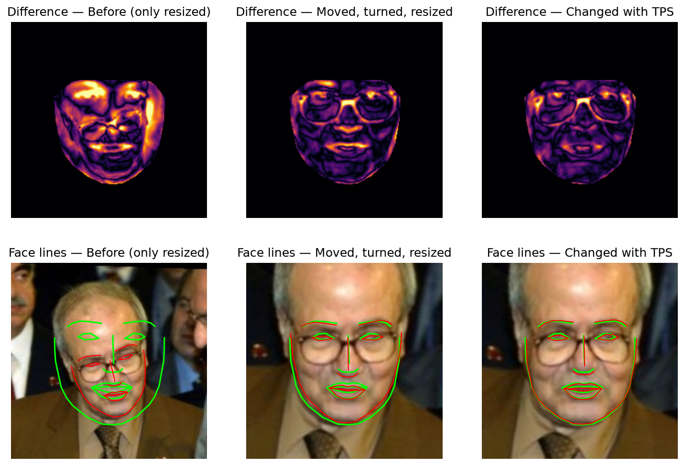

# Nonlinear Image Registration of Faces Based on Landmarks

Nonlinear image registration of facial photographs: landmark detection, average face
construction, and thin-plate spline warping, with quantitative and qualitative evaluation.

**Status: first prototype.** This is a small test. We use 10 photos to make an average
face, and 1 new photo to test the method. See [`prototype.ipynb`](prototype.ipynb).

## What it does

1. **Find the landmarks.** MediaPipe (a free tool from Google) finds important points on
   each face. We keep 68 points: jaw, eyebrows, nose, eyes and mouth.
   OpenFace also uses these 68 points.
2. **Make an average face.** We put all faces in the same position and size
   (Procrustes alignment). Then we calculate the average position of each point.
   We change the shape of every photo to this average shape, and we calculate the
   average photo.
3. **Change the shape of a new photo.** We use a thin-plate spline (TPS). It works like a
   sheet of rubber: we pull the 68 points of the photo to the points of the average face.
4. **Check the result.** We find the points again on the new photo. We measure the
   distance to the average face. We also look at difference pictures and face lines.

## Result of the prototype (one new photo)

Smaller is better.

| version | mean error (pixels) | error / eye distance |
|---|---|---|
| before (only resized) | 24.2 | 0.278 |
| moved, turned and resized | 3.9 | 0.045 |
| **changed with TPS** | **2.1** | **0.024** |



## How to run it

```bash
python3.11 -m venv ~/.venvs/ipcv
source ~/.venvs/ipcv/bin/activate
pip install -r requirements.txt
python -m ipykernel install --user --name ipcv --display-name "Python (ipcv)"
python scripts/download_data.py      # gets the MediaPipe model and 60 face photos
jupyter notebook prototype.ipynb
```

## Files

```
src/facereg/
  landmarks.py   find the 68 landmarks
  shape.py       put shapes in the same position, average shape
  tps.py         thin-plate spline: change the shape of a photo
  metrics.py     error measures and difference images
  pipeline.py    the main steps put together
  viz.py         drawing helpers
scripts/         download data, create the notebook
results/         figures and numbers
```

## Data

Photos from [Labeled Faces in the Wild](http://web.archive.org/web/20250105180242/http://vis-www.cs.umass.edu/lfw/) (LFW), a free
face dataset. We use 60 random people, one photo for each person.

## Bibliography

### Image registration
- Zitová, B., & Flusser, J. (2003). Image registration methods: a survey.
  *Image and Vision Computing, 21*(11), 977–1000.
  — General introduction to image registration.

### Thin-plate splines and other nonlinear methods
- Bookstein, F. L. (1989). Principal warps: Thin-plate splines and the decomposition of
  deformations. *IEEE Transactions on Pattern Analysis and Machine Intelligence, 11*(6),
  567–585. — The TPS method that we use.
- Wahba, G. (1990). *Spline Models for Observational Data*. SIAM.
  — TPS with regularisation (the λ setting).
- Rueckert, D., Sonoda, L. I., Hayes, C., Hill, D. L. G., Leach, M. O., & Hawkes, D. J.
  (1999). Nonrigid registration using free-form deformations: application to breast MR
  images. *IEEE Transactions on Medical Imaging, 18*(8), 712–721.
  — B-splines, another nonlinear method.

### Shape alignment and the average shape
- Gower, J. C. (1975). Generalized Procrustes analysis. *Psychometrika, 40*(1), 33–51.
  — The method we use to make the average shape.
- Umeyama, S. (1991). Least-squares estimation of transformation parameters between two
  point patterns. *IEEE Transactions on Pattern Analysis and Machine Intelligence, 13*(4),
  376–380. — How we move, turn and resize one set of points onto another.

### Landmark detection
- Kartynnik, Y., Ablavatski, A., Grishchenko, I., & Grundmann, M. (2019). Real-time facial
  surface geometry from monocular video on mobile GPUs. *arXiv:1907.06724*.
  — The face mesh model (478 points) inside MediaPipe.
- Lugaresi, C., Tang, J., Nash, H., McClanahan, C., Uboweja, E., Hays, M., Zhang, F.,
  Chang, C.-L., Yong, M. G., Lee, J., Chang, W.-T., Hua, W., Georg, M., & Grundmann, M.
  (2019). MediaPipe: A framework for building perception pipelines. *arXiv:1906.08172*.
- Sagonas, C., Tzimiropoulos, G., Zafeiriou, S., & Pantic, M. (2013). 300 Faces in-the-Wild
  Challenge: The first facial landmark localization challenge. In *Proceedings of the IEEE
  International Conference on Computer Vision Workshops* (pp. 397–403).
  — The standard 68-point layout.
- Baltrušaitis, T., Zadeh, A., Lim, Y. C., & Morency, L.-P. (2018). OpenFace 2.0: Facial
  behavior analysis toolkit. In *13th IEEE International Conference on Automatic Face &
  Gesture Recognition (FG 2018)* (pp. 59–66). — The tool suggested in the project description.

### Data
- Huang, G. B., Ramesh, M., Berg, T., & Learned-Miller, E. (2007). *Labeled Faces in the
  Wild: A database for studying face recognition in unconstrained environments*
  (Technical Report 07-49). University of Massachusetts, Amherst.
- Huang, G. B., Jain, V., & Learned-Miller, E. (2007). Unsupervised joint alignment of
  complex images. In *Proceedings of the IEEE International Conference on Computer Vision
  (ICCV)*. — How the "funneled" LFW photos were made.

### Software
- Bradski, G. (2000). The OpenCV library. *Dr. Dobb's Journal of Software Tools*.
- Harris, C. R., et al. (2020). Array programming with NumPy. *Nature, 585*, 357–362.
- Virtanen, P., et al. (2020). SciPy 1.0: Fundamental algorithms for scientific computing
  in Python. *Nature Methods, 17*, 261–272.
- Hunter, J. D. (2007). Matplotlib: A 2D graphics environment. *Computing in Science &
  Engineering, 9*(3), 90–95.
- Pedregosa, F., et al. (2011). Scikit-learn: Machine learning in Python. *Journal of
  Machine Learning Research, 12*, 2825–2830.
